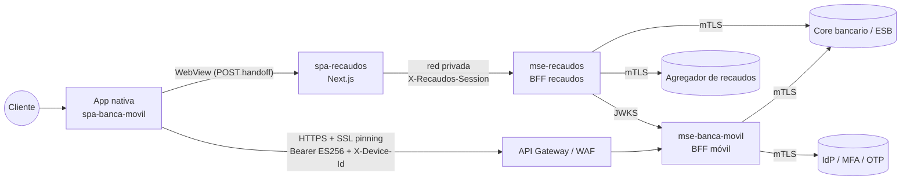
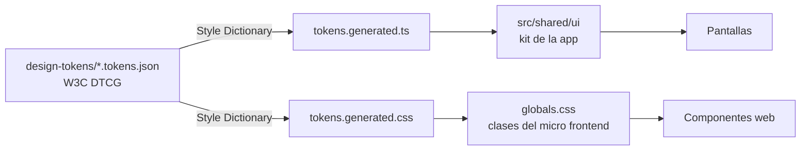
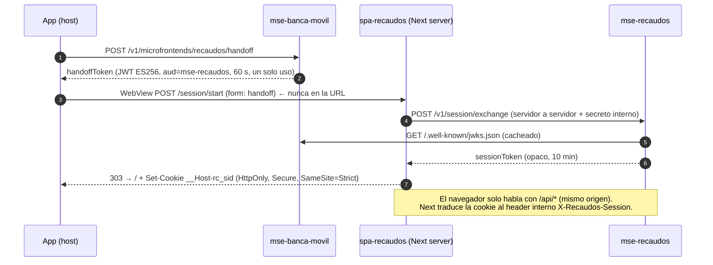
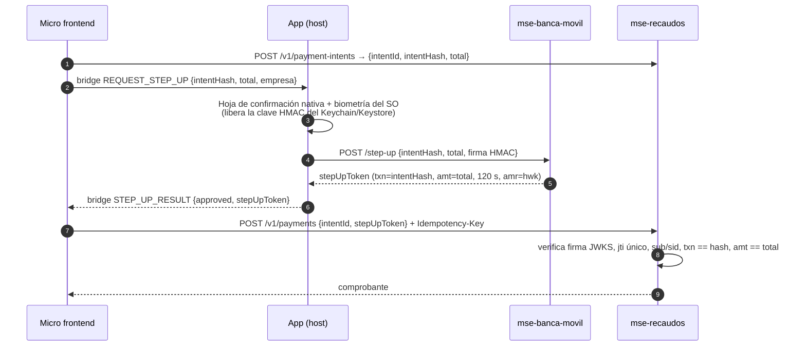
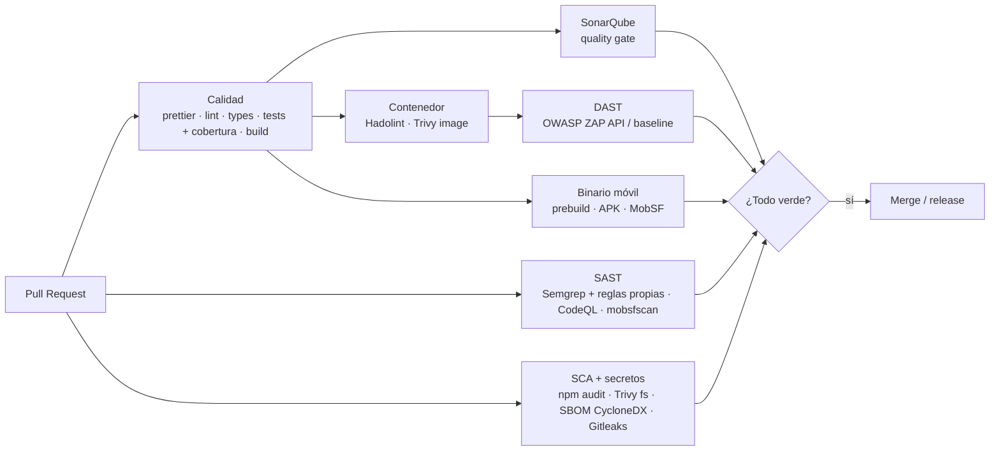

# Arquitectura — Banca Móvil (MVP)

Documento maestro de la solución. Abarca los 4 repositorios:

| Repositorio | Rol | Tecnología |
|---|---|---|
| **spa-banca-movil** | App nativa iOS/Android (host) | React Native + Expo (CNG, Expo Router), TypeScript |
| **mse-banca-movil** | BFF de la app nativa | NestJS 12 (ESM), Zod, jose (JWT ES256) |
| **spa-recaudos** | Micro frontend *Pago de servicios* (embebido en WebView) | Next.js 16 (App Router), React 19 |
| **mse-recaudos** | BFF del micro frontend de recaudos | NestJS 12 (ESM), Zod, jose (JWKS) |

## 1. Alcance funcional del MVP (10 funcionalidades)

| # | Funcionalidad | Módulo | Dónde vive |
|---|---|---|---|
| 1 | Login con documento + clave | Autenticación | App + mse-banca-movil |
| 2 | Segundo factor OTP (MFA obligatorio) | Autenticación | App + mse-banca-movil |
| 3 | Desbloqueo biométrico (refresh token en Keychain/Keystore) + cierre de sesión | Autenticación | App + mse-banca-movil |
| 4 | Posición consolidada (cuentas, tarjetas, préstamos) | Posición consolidada | App + mse-banca-movil |
| 5 | Movimientos por cuenta | Posición consolidada | App + mse-banca-movil |
| 6 | Transferencias entre cuentas propias | Transferencias | App + mse-banca-movil |
| 7 | Transferencias a terceros e interbancarias (OTP por umbral) | Transferencias | App + mse-banca-movil |
| 8 | Pago de tarjeta de crédito (mínimo / total / otro monto) | Pago de tarjetas | App + mse-banca-movil |
| 9 | Pago de servicios (búsqueda, consulta de deuda, pago) | Pago de servicios | **spa-recaudos + mse-recaudos** (WebView) |
| 10 | Comprobante + compartir nativo | Pago de servicios | spa-recaudos + puente nativo |

Crecimiento: cada nueva capacidad entra como **feature module** en la app (`src/features/<feature>`) y en el BFF (`src/modules/<feature>`), o como **nuevo micro frontend + BFF** cuando su ciclo de vida es independiente (p. ej. seguros, inversiones), reutilizando el mismo puente y el mismo mecanismo de *handoff*.

## 2. Vista de contexto



## 3. Estilo arquitectónico

- **Backend for Frontend (BFF) por canal**: cada frontend tiene su BFF dueño de su contrato. El BFF agrega, adapta y aplica seguridad; **no** contiene reglas contables (viven en el core).
- **Micro frontends verticales**: *Pago de servicios* se despliega de forma independiente (repo, pipeline, equipo) y se integra en la app por **WebView + puente tipado**. El usuario percibe una experiencia nativa: la cabecera, el botón atrás, la confirmación biométrica, los hápticos y el compartir son nativos.
- **Arquitectura hexagonal en los BFF**: controladores (adaptadores de entrada) → servicios de aplicación → **puertos** (`CoreBankingPort`, `BillersPort`, `AccountsPort`) → adaptadores de salida (en memoria para dev/test; HTTP/mTLS en producción). Cambiar el core no toca la lógica.
- **Feature-first + capas en la app**: `src/app` (rutas Expo Router, solo UI y navegación) · `src/features/*` (API y lógica por funcionalidad) · `src/core/*` (seguridad, red, sesión, configuración transversal) · `src/shared/ui` (design system).

### Estructura de la app nativa

```
src/
  app/                    # Rutas (Expo Router). Grupos protegidos: (auth) y (app)
    (auth)/login, otp
    (app)/index (posición), accounts/[id], transfers/, payments/{index,card,services}
  core/
    api/http.ts           # Cliente HTTP: timeout, X-Request-Id, X-Device-Id, refresh single-flight
    security/             # SecureStore, device id, integridad (root/jailbreak), pinning,
                          # firma de transacciones biométrica (HMAC), SecurityGate
    session/              # Estado de sesión (access token solo en memoria)
  features/
    auth/ position/ transfers/ card-payments/
    service-payments/     # Host WebView + puente nativo (contrato compartido)
  shared/ui/              # API pública de UI; ÚNICA capa con primitivas visuales
    contract.ts           # contrato de componentes (UiKit)
    kit.ts                # selección del adaptador (1 línea)
    adapters/default/     # kit propio; adapters/<ds>/ para el Design System del banco
    __tests__/            # suite de conformidad del contrato
    tokens.generated.ts   # generado desde design-tokens/ (no editar)
design-tokens/            # Fuente única de estilo (W3C DTCG), compartida con spa-recaudos
```

### Design System y Design Tokens



- Una sola fuente de tokens (primitivos + semánticos por tema claro/oscuro) genera el estilo de **ambos** frontends: la app y el micro frontend se ven idénticos y cambian juntos.
- Las pantallas no conocen valores visuales: la app solo importa `src/shared/ui` (ESLint prohíbe primitivas de `react-native`, estilos inline y colores fijos en `src/app` y `src/features`); el micro frontend solo usa clases basadas en `var(--…)`.
- **Cambiar al Design System del banco**: reemplazar los `*.tokens.json` (o leerlos desde su paquete npm) manteniendo las claves semánticas del contrato — ver [`design-tokens/README.md`](../design-tokens/README.md). No se modifican pantallas.
- CI: los archivos generados deben estar al día y la carpeta `design-tokens/` debe ser idéntica en ambos repos (`contracts/design-tokens.sha256`).
- **Componentes intercambiables (React Native)**: las pantallas usan un contrato de componentes (`src/shared/ui/contract.ts`) implementado por un adaptador elegido en una sola línea (`src/shared/ui/kit.ts`). El adaptador por defecto es el kit propio; el del Design System del banco envuelve su librería. Una suite de conformidad (comportamiento, accesibilidad y seguridad, p. ej. campos de clave ocultos y sin copiar/pegar) valida en CI el adaptador activo. Guía: [`src/shared/ui/adapters/README.md`](../src/shared/ui/adapters/README.md).

## 4. Autenticación y gestión de sesión

```mermaid
sequenceDiagram
  autonumber
  participant A as App
  participant B as mse-banca-movil
  A->>B: POST /v1/auth/login {documento, clave, deviceId}
  B-->>A: {challengeId} (OTP enviado; rate limit + bloqueo por intentos)
  A->>B: POST /v1/auth/mfa/verify {challengeId, otp, deviceId}
  B-->>A: access token ES256 (5 min, ligado a sid+deviceId) + refresh opaco (rotativo)
  Note over A: refresh → Keychain/Keystore con biometría<br/>access → solo memoria
  A->>B: POST /v1/devices/signing-key {clave HMAC 32B} (≤ 5 min tras MFA)
  A->>B: POST /v1/auth/refresh (rotación; reutilización ⇒ revoca la sesión)
```

- Access token: JWT **ES256**, `typ=at+jwt`, `aud=mse-banca-movil`, TTL 5 min, claims `sid` (revocable) y `did` (device binding: el BFF exige que `X-Device-Id` coincida).
- Refresh token: opaco, guardado **hasheado** en servidor, **rotación obligatoria** con detección de reutilización.
- Bloqueo automático: 5 min de inactividad o 60 s en segundo plano ⇒ la sesión pasa a `locked` y requiere biometría.

## 5. Integración del micro frontend (WebView)

### 5.1 Handoff de sesión (sin compartir tokens de la app)



### 5.2 Pago con confirmación nativa (step-up ligado a la transacción)



### 5.3 Contrato del puente (v1)

Archivo único `protocol.ts` (Zod), **idéntico** en `spa-banca-movil/src/features/service-payments/bridge/` y `spa-recaudos/src/lib/bridge/`. El CI de ambos repos verifica su hash (`contracts/bridge-protocol.sha256`).

| Dirección | Mensaje | Uso |
|---|---|---|
| Web → App | `READY` | El micro frontend cargó; la app responde `INIT` |
| Web → App | `SET_HEADER {title, canGoBack}` | Cabecera **nativa** |
| Web → App | `REQUEST_STEP_UP {intentHash, amount, currency, billerName, reference}` | Confirmación biométrica + token de transacción |
| Web → App | `SHARE_RECEIPT {text}` | Hoja nativa de compartir |
| Web → App | `HAPTIC {style}` | Feedback háptico |
| Web → App | `SESSION_EXPIRED` / `CLOSE {reason}` | Ciclo de vida |
| Web → App | `OPEN_NATIVE {route: position\|transfers}` | Navegación nativa (allowlist cerrada) |
| App → Web | `INIT {locale, theme, platform, appVersion}` | Tema/idioma nativos |
| App → Web | `STEP_UP_RESULT {approved\|cancelled\|failed}` | Respuesta correlacionada por `replyTo` |
| App → Web | `BACK_PRESSED` | Botón atrás nativo / hardware |
| App → Web | `APP_STATE {active\|background}` | Difuminar datos en segundo plano |

Sobre: `{ v: 1, id, replyTo?, ts, source, type, payload }`, máx. 8 KB. Ambos lados descartan mensajes que no cumplen el schema; la app además valida el **origen** de la página emisora. Los mensajes App → Web se inyectan con doble `JSON.stringify` (no hay forma de romper el literal JS).

Versionado: cambios compatibles ⇒ campos opcionales; incompatibles ⇒ `v: 2` y la app soporta N-1 durante al menos una versión en tiendas.

## 6. Seguridad por capas (resumen)

Detalle completo en [`SECURITY.md`](SECURITY.md). Referencias: OWASP MASVS v2, OWASP ASVS 4 (nivel 2-3), OWASP API Security Top 10 2023, PCI DSS 4.0.

| Capa | Controles principales |
|---|---|
| App | Keychain/Keystore (`THIS_DEVICE_ONLY`), biometría **criptográfica** (HMAC con clave protegida), SSL pinning SPKI, detección root/jailbreak/hooking, bloqueo de capturas y app switcher, timeout de sesión, `allowBackup=false`, ATS, permisos bloqueados (overlays) |
| WebView | Allowlist de orígenes, `incognito`, sin acceso a archivos, sin contenido mixto, sin ventanas nuevas, depuración solo en dev, validación de origen + schema en cada mensaje |
| Micro frontend | CSP con nonce + `strict-dynamic`, `frame-ancestors 'none'`, cookie `__Host-` HttpOnly/Secure/SameSite=Strict, proxy con allowlist de rutas, sin secretos en el bundle, sin `localStorage` para sesión |
| BFF | Deny-by-default, validación Zod estricta (anti mass-assignment), BOLA, rate limiting, idempotencia, montos resueltos en servidor, errores RFC 9457 sin detalles internos, headers de seguridad, `Cache-Control: no-store`, logs sin PII |
| Tokens | ES256, `typ` explícito por uso (`at+jwt`, `handoff+jwt`, `stepup+jwt`) contra confusión de tokens, audiencias separadas, `jti` de un solo uso, TTL cortos, JWKS con rotación por `kid` |
| Plataforma | WAF + API Gateway, mTLS interno, secretos en Vault/KMS, contenedores no-root con FS de solo lectura, imágenes escaneadas |

## 7. DevSecOps (pipeline por repositorio)



| Práctica | Herramienta | Repos | Bloquea |
|---|---|---|---|
| Formato / estilo | Prettier, ESLint (Expo/Next), oxlint type-aware (Nest) | todos | sí |
| Tipado estricto | TypeScript `strict` (+ `noUncheckedIndexedAccess` en app) | todos | sí |
| Pruebas | Vitest (BFF, Next), Jest (app), e2e de seguridad (Supertest) | todos | sí |
| Calidad / deuda | SonarQube (cobertura ≥ 80 % código nuevo, 0 vulnerabilidades, hotspots revisados) | todos | sí (quality gate) |
| SAST | Semgrep (OWASP Top 10, React/Next, Node, JWT, secretos) + **reglas propias** en `.semgrep/rules.yml` | todos | sí |
| SAST | CodeQL `security-extended` | todos | alertas en Security tab |
| SAST móvil | mobsfscan (MASVS) con excepciones justificadas en `.mobsf` | app | sí |
| SCA | `npm audit` (prod, HIGH+), Trivy fs, Dependabot, SBOM CycloneDX | todos | sí |
| Secretos | Gitleaks (historial completo) + Trivy secret | todos | sí |
| Contenedores | Hadolint, Trivy image | BFFs, Next | sí |
| DAST | OWASP ZAP API scan **autenticado** (mse-banca-movil), API scan (mse-recaudos), baseline (spa-recaudos) | BFFs, Next | sí (alertas High) |
| Binario móvil | MobSF sobre APK release (score mínimo + 0 high) | app | sí |
| Contratos | Hash del contrato del puente y de los design tokens; tokens generados al día; sin colores literales | app, Next | sí |

## 8. Despliegue (referencia)

- **BFFs y Next**: contenedores en Kubernetes/ECS detrás de API Gateway + WAF. `mse-recaudos` **no** se expone a Internet: solo el servidor Next lo alcanza (NetworkPolicy). Pods con `runAsNonRoot`, `readOnlyRootFilesystem`, `allowPrivilegeEscalation: false`, límites de recursos, HPA.
- **App**: EAS Build/Submit con perfiles `development`, `qa`, `production` (`APP_ENV`). Firma en la nube, credenciales fuera del repo. OTA (EAS Update) solo para JS firmado y en el mismo runtime version.
- **Estado**: sesiones, idempotencia, `jti` usados y OTP pasan de memoria a **Redis** (TLS, TTL) sin cambiar interfaces.
- **Observabilidad**: OpenTelemetry (trazas con `X-Request-Id` de extremo a extremo), logs estructurados sin PII hacia el SIEM del banco.

## 9. Ejecución local

```bash
# 1) BFF móvil (puerto 3000) — usuario demo 12345678 / Demo#2026, OTP 123456
cd mse-banca-movil && npm ci && npm run start:dev
# 2) BFF recaudos (3001) — usa el JWKS de 3000
cd mse-recaudos && npm ci && npm run start:dev
# 3) Micro frontend (3002)
cd spa-recaudos && npm ci && npm run dev -- -p 3002
# 4) App (development build; requiere módulos nativos)
cd spa-banca-movil && npm ci && npx expo run:android   # o run:ios
```

## 10. Hoja de ruta técnica

1. Claves de firma **asimétricas** en Secure Enclave / StrongBox (o passkeys FIDO2) — el servidor guarda solo la clave pública.
2. Atestación de app y dispositivo en servidor (**Play Integrity API**, **App Attest**) como señal de riesgo por transacción.
3. RASP comercial (p. ej. freeRASP/Talsec) y ofuscación del bundle Hermes.
4. Motor de fraude/riesgo (geolocalización, velocidad, beneficiario nuevo) y límites diarios configurables.
5. Redis para estado distribuido; outbox transaccional para notificaciones.
6. Pruebas de contrato (Pact) entre micro frontend ↔ BFF y app ↔ BFF.
7. Pentest independiente (MASTG) antes de cada release mayor.
